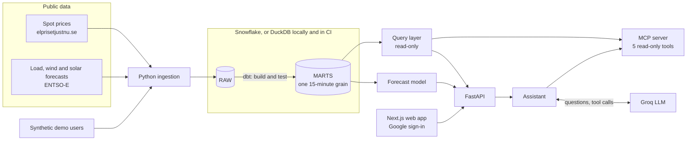

# Elkollen

**An electricity assistant for Sweden, built on 15-minute day-ahead prices.**

Sweden's electricity price changes every 15 minutes. Elkollen shows what it costs right
now and later today, finds the cheapest time to run the dishwasher or charge a car,
forecasts tomorrow before the prices are out, and answers questions in plain language
without making numbers up.

**Live demo: [elkollen-rose.vercel.app](https://elkollen-rose.vercel.app)** (try the assistant
with the demo login; all users there are invented).

> Portfolio project. Everything below is either tested or marked as not verified. Details: [docs/how-it-works.md](docs/how-it-works.md).

## What you can do

- **See the price per quarter-hour**, today and tomorrow, for each price area (SE1–SE4).
- **Find the cheapest window** for the dishwasher (2 h), washing machine (3 h) or car
  charging (4 h), and how much it saves.
- **Get tomorrow's forecast** before prices are published (about 13:00), with its own
  track record shown next to it.
- **Ask the assistant** ("Why is it so expensive at 17:00?"). It can only answer from
  the data tools, and every number it writes is checked against them.
- **Upload your consumption file** to see what you paid and what you could have paid.
  The file is analysed in memory and never stored.

## How it fits together



In words: public data is loaded into a **RAW** layer, **dbt** turns it into clean tables on
one 15-minute grain and tests them, and everything the user sees reads those tables
through one **read-only query layer**. The **assistant** never queries data itself: it
asks the **MCP tools**, which can only see the signed-in user's own data.

## Why it is harder than it looks

- **Two time grains.** Prices were hourly until 30 Sep 2025 and are 15-minute since. All
  history is put on one 15-minute grain, with hourly values flagged.
- **Daylight saving.** A Swedish day has 96 quarter-hours, but 92 in March and 100 in
  October. Tests check every day against the calendar, plus gaps and duplicates.
- **Negative prices are real** and must pass the checks.
- **User A must never see user B.** Tested through the API and the MCP server, not just
  promised.

## Does the forecast work?

Tested on 60 days the model had never seen (26 Sep – 24 Nov 2026), against the simple rule
"same price as this quarter yesterday". Average error in öre/kWh, lower is better:

| Area | "Same as yesterday" | Elkollen forecast | Verdict |
|---|---|---|---|
| SE1 | 28.32 | **21.80** (−23 %) | beats it |
| SE2 | 32.14 | **20.44** (−36 %) | beats it |
| SE3 | 51.76 | **39.31** (−24 %) | beats it |
| SE4 | 62.70 | **54.02** (−14 %) | not proven |

"Beats it" means the gain held up in a statistical test; in SE4 it did not. Using prices
alone, the gain in SE3 and SE4 was not proven; tomorrow's wind and load forecasts made the
difference. Full numbers: [reports/forecast_backtest.json](reports/forecast_backtest.json).

## Tech

| Part | Tools |
|---|---|
| Warehouse | Snowflake (Terraform: roles, masking and row access policies, cost monitor); DuckDB locally and in CI |
| Transform | dbt (data tests, unit tests, DST-aware checks) |
| Ingestion | Python, httpx, pydantic |
| Backend | FastAPI, MCP Python SDK, short-lived signed tokens |
| Assistant | Groq (`openai/gpt-oss-120b`) through MCP tools, with a number check |
| Forecast | scikit-learn ridge regression, walk-forward test, bootstrap verdict |
| Frontend | Next.js, TypeScript, Tailwind, Auth.js (Google) |
| CI | GitHub Actions: ruff + pytest, dbt build, web typecheck/lint/test/build, Terraform validate |

## Run it locally

No cloud account needed: DuckDB, saved real price responses and invented demo users.

```powershell
pip install -c requirements-lock.txt -e ".[dev,dbt,api,forecast]"
$env:DUCKDB_PATH = "data/elkollen.duckdb"

elkollen-ingest load-fixtures fixtures/elpris
elkollen-ingest load-entsoe-fixtures fixtures/entsoe
elkollen-ingest synthetic-consumption --start 2025-09-29 --end 2025-10-05
dbt build --project-dir dbt --profiles-dir dbt --exclude tag:live `
  --vars '{price_continuity_start: "2025-09-29", price_continuity_end: "2025-10-05"}'
pytest
```

Then start the API (`uvicorn elkollen_api.app:create_app --factory --port 8000`), the MCP
server (`elkollen-mcp`) and the web app (`cd web; npm install; npm run dev`). Settings are
listed in [.env.example](.env.example).

## Privacy

- The public demo uses **invented users only**. No real meter data is committed or loaded.
- Uploaded consumption files are analysed in memory and **not stored**.
- Meter ids and addresses are masked for the app's database role, and deleted users are
  hidden by a row access policy. Details: [decision 0003](docs/decisions/0003-user-isolation-and-privacy.md).

## Not done or not verified

- **The demo runs on free plans:** the backend would sleep after 15 minutes without visitors;
  a GitHub Actions ping every 10 minutes keeps it awake, but GitHub sometimes starts that
  job late, so a slow first visit (about a minute) can still happen. Data is in a Snowflake trial that ends in
  December; the demo moves to DuckDB or a paid plan before then. How it is deployed:
  [docs/deploy.md](docs/deploy.md).
- The SE4 forecast gain is not proven. Wind and solar forecasts may be published after the
  prices, so the forecast test may be a little optimistic.
- ENTSO-E's licence wording is not verified, so no real ENTSO-E data is committed.
- More: [docs/how-it-works.md](docs/how-it-works.md),
  [docs/data-sources.md](docs/data-sources.md) and a 5-minute
  [demo script](docs/demo-script.md).

## Credits

Prices: [elprisetjustnu.se](https://www.elprisetjustnu.se) (from the ENTSO-E Transparency
Platform). Load, wind and solar forecasts: [ENTSO-E Transparency
Platform](https://transparency.entsoe.eu), published by Svenska kraftnät.
