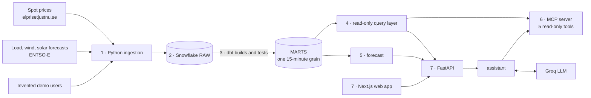

# Elkollen

**An electricity assistant for Sweden, built on 15-minute day-ahead prices.**

**Live demo: [elkollen-rose.vercel.app](https://elkollen-rose.vercel.app)** · try the
assistant with the demo login (all users there are invented).

> Portfolio project. Everything here is either tested or marked as not verified.

---

## How it started

I first built a small tool that found the cheapest **hours** for electricity in Sweden.
Someone commented: the price isn't set per hour any more. Since 1 October 2025 the
day-ahead market sets a price for **every 15 minutes**.

That one sentence changed the problem:

- A day is no longer 24 prices but **96**, and **92 or 100** on the days the clocks change.
- The old hourly history still has to fit together with the new 15-minute data.
- Prices can be **negative**, and that is real, not an error.
- If people can ask questions about their own usage, **user A must never see user B**.

Elkollen is the rebuild. This README follows a price on its way from the market to your
screen, and names the files that do each step.

## What it does

- Shows the price **right now** and for the next few hours, quarter by quarter, in SE1–SE4.
- Finds the **cheapest window** for the dishwasher (2 h), washing machine (3 h) or car (4 h).
- **Forecasts tomorrow** before prices are published (about 13:00) and shows its track record.
- Lets you **ask questions** in Swedish or English; every number in an answer is checked.
- Shows what your **own usage file** cost and could have cost, without storing it.

## The journey of a price



### 1 · Getting the data: Python ingestion

Twice a day (13:50 and 16:50 Stockholm time) a GitHub Actions job fetches today's and
tomorrow's prices from [elprisetjustnu.se](https://www.elprisetjustnu.se) and the grid
forecasts (load, wind, solar) from the [ENTSO-E Transparency Platform](https://transparency.entsoe.eu).
Every response is validated before anything is stored: wrong timestamps, missing intervals
and impossible values are refused, not silently fixed.

| File | What it does |
|---|---|
| [`src/elkollen_ingest/elpris.py`](src/elkollen_ingest/elpris.py) | Price API client with polite retries; validates every day (and notes a real quirk: on the autumn clock change the source reports one interval end an hour late) |
| [`src/elkollen_ingest/entsoe.py`](src/elkollen_ingest/entsoe.py) | ENTSO-E XML parser; fills values the API leaves out on purpose; never logs the API token |
| [`src/elkollen_ingest/sinks.py`](src/elkollen_ingest/sinks.py) | Writes rows to Snowflake or DuckDB; only tables on an allow-list |
| [`src/elkollen_ingest/synthetic.py`](src/elkollen_ingest/synthetic.py) | Invented demo users and 15-minute consumption, so no real meter data is ever needed |
| [`src/elkollen_ingest/cli.py`](src/elkollen_ingest/cli.py) | The `elkollen-ingest` command (prices, ENTSO-E, fixtures, demo users) |
| [`.github/workflows/ingest-prices.yml`](.github/workflows/ingest-prices.yml) | The twice-daily job: fetch, then dbt build and a freshness check |

### 2 · Storing it safely: Snowflake, set up with Terraform

Data lands untouched in a **RAW** schema, so it can always be rebuilt. Every Snowflake object
is code, not clicks: a database with RAW, STAGING and MARTS schemas, an extra-small warehouse
that suspends after 60 seconds, a **resource monitor capping use at 5 credits a month**, and
**least-privilege service users** (one to load, one to transform, one for the app to read),
each signing in with a key pair.

| File | What it does |
|---|---|
| [`infra/terraform/main.tf`](infra/terraform/main.tf) | Database, schemas, warehouse, resource monitor |
| [`infra/terraform/roles.tf`](infra/terraform/roles.tf) | Roles, service users and grants: the loader can only insert into RAW, the app can only read MARTS |
| [`infra/terraform/native_ingestion.tf`](infra/terraform/native_ingestion.tf) | Optional Snowflake-native ingestion (switched off; see [decision 0002](docs/decisions/0002-hybrid-ingestion.md)) |

Locally and in CI the same models run on **DuckDB** instead, so anyone can run the project
without a cloud account ([decision 0001](docs/decisions/0001-duckdb-for-local-and-ci.md)).

### 3 · One clean timeline: dbt

dbt turns raw rows into tables people can trust. The key model puts **all history on one
15-minute grain**: an hourly price from before October 2025 becomes four quarters with the
same price, flagged so nobody mistakes it for real 15-minute data.

Then the tests. Every day must have exactly as many quarters as the Swedish calendar says
(96, or 92/100 on clock-change days), with no gaps, no duplicates and all four areas present.
The tests were run against corrupted data to prove they actually fail.

| File | What it does |
|---|---|
| [`dbt/models/staging/`](dbt/models/staging) | Cleans each source: latest load wins, UTC and local time, units |
| [`dbt/models/intermediate/int_prices__15min.sql`](dbt/models/intermediate/int_prices__15min.sql) | Turns hourly history into 15-minute rows (flagged) |
| [`dbt/models/marts/prices/fct_prices_15min.sql`](dbt/models/marts/prices/fct_prices_15min.sql) | The main table: one row per area and quarter-hour |
| [`dbt/models/marts/grid/fct_grid_forecast_15min.sql`](dbt/models/marts/grid/fct_grid_forecast_15min.sql) | Load, wind and solar forecasts on the same grain |
| [`dbt/models/marts/prices/mart_price_freshness.sql`](dbt/models/marts/prices/mart_price_freshness.sql) | Answers "are tomorrow's prices in yet?" |
| [`dbt/models/marts/consumption/`](dbt/models/marts/consumption) | Demo users and their consumption priced in their own area |
| [`dbt/tests/generic/expected_intervals_per_day.sql`](dbt/tests/generic/expected_intervals_per_day.sql) | The daylight-saving test: compares each day with the calendar |
| [`dbt/macros/privacy.sql`](dbt/macros/privacy.sql) | Snowflake masking (meter ids, addresses) and a row access policy that hides deleted users |

### 4 · One door to the data: the query layer

Everything the app and the assistant know comes through one read-only Python module. It
validates every input, caps every read at 2,000 rows, and returns not just numbers but
**where they came from and what they exclude** (VAT, tax, grid fees).

| File | What it does |
|---|---|
| [`src/elkollen_data/queries.py`](src/elkollen_data/queries.py) | Prices, cheapest window, cost of my usage, plan comparison, price-spike explanation, alerts |
| [`src/elkollen_data/warehouse.py`](src/elkollen_data/warehouse.py) | Same queries on Snowflake or DuckDB |
| [`src/elkollen_data/upload.py`](src/elkollen_data/upload.py) | Reads a Swedish consumption CSV in memory and prices it; nothing is stored |

### 5 · Guessing tomorrow: the forecast

Before 13:00, tomorrow's prices don't exist yet, so Elkollen forecasts them. The model
(ridge regression, ported from my earlier [elpris-forecast](https://github.com/thar-26/elpris-forecast))
uses only what is known today: recent prices plus ENTSO-E's forecasts of tomorrow's load,
wind and solar. A test changes a day's prices and checks that day's own inputs don't move,
so the model can't peek at the answer.

It was tested walk-forward on 60 days it had never seen, against the simple rule "same
price as this quarter yesterday" (average error in öre/kWh, lower is better):

| Area | "Same as yesterday" | Elkollen | Verdict |
|---|---|---|---|
| SE1 | 28.32 | **21.80** (−23 %) | beats it |
| SE2 | 32.14 | **20.44** (−36 %) | beats it |
| SE3 | 51.76 | **39.31** (−24 %) | beats it |
| SE4 | 62.70 | **54.02** (−14 %) | not proven |

"Beats it" means the gain held up in a bootstrap test; in SE4 it did not, and the app says so.

| File | What it does |
|---|---|
| [`src/elkollen_forecast/model.py`](src/elkollen_forecast/model.py) | Features, walk-forward test, verdict, next-day forecast |
| [`reports/forecast_backtest.json`](reports/forecast_backtest.json) | The full backtest numbers shown above |

### 6 · An assistant that can't make numbers up: MCP

The assistant (Groq, `openai/gpt-oss-120b`) never touches the database. It can only call
**five read-only MCP tools**: `get_prices`, `cheapest_window`, `cost_of_my_usage`,
`compare_plans` and `explain_spike`. The tools take the user from a signed, short-lived
token, never from the question, so asking for someone else's bill returns nothing.

After the model answers, a **grounding check** compares every number in the text with the
numbers the tools returned and flags any it can't find. The app also shows which tools were
called and with what.

| File | What it does |
|---|---|
| [`src/elkollen_mcp/server.py`](src/elkollen_mcp/server.py) | MCP server (official Python SDK): token check, the five tools, audit log |
| [`src/elkollen_chat/agent.py`](src/elkollen_chat/agent.py) | Runs the conversation: model ↔ MCP tools, with a step limit |
| [`src/elkollen_chat/grounding.py`](src/elkollen_chat/grounding.py) | The number check |
| [`src/elkollen_auth/`](src/elkollen_auth) | Signs and verifies the short-lived tokens |

### 7 · The app people see: FastAPI and Next.js

| File | What it does |
|---|---|
| [`src/elkollen_api/app.py`](src/elkollen_api/app.py) | FastAPI: public price routes, signed-in routes, `/chat`, rate limit; slow database calls run off the main loop so the health check always answers |
| [`web/src/app/page.tsx`](web/src/app/page.tsx) | Start page: today and tomorrow, forecast, alerts, assistant |
| [`web/src/components/DayView.tsx`](web/src/components/DayView.tsx) | The quarter-hour view and the cheapest window |
| [`web/src/components/PriceChart.tsx`](web/src/components/PriceChart.tsx) | The 96-bar chart, with a "Show as table" view of the same numbers |
| [`web/src/components/ChatPanel.tsx`](web/src/components/ChatPanel.tsx) | The assistant and "How this answer was made" |
| [`web/src/app/upload/page.tsx`](web/src/app/upload/page.tsx) | Upload your consumption file |
| [`web/src/auth.ts`](web/src/auth.ts) | Google sign-in (Auth.js) and the demo login |
| [`web/src/lib/i18n.ts`](web/src/lib/i18n.ts) | Swedish and English text |

### 8 · Keeping it running

| File | What it does |
|---|---|
| [`Dockerfile`](Dockerfile), [`deploy/start-backend.sh`](deploy/start-backend.sh) | One container on Render: the API in public, the MCP server only on localhost |
| [`render.yaml`](render.yaml) | Render setup; secrets are typed into Render, never stored here |
| [`.github/workflows/ci.yml`](.github/workflows/ci.yml) | On every pull request: ruff + pytest, dbt build, web typecheck/lint/test/build, Terraform validate |
| [`.github/workflows/keep-awake.yml`](.github/workflows/keep-awake.yml) | Pings the free backend every 10 minutes so it doesn't fall asleep |
| [`docs/deploy.md`](docs/deploy.md) | How it is deployed (Vercel, Render, Snowflake) |

## How I know it works

- **255 Python tests** ([`tests/`](tests)), 15 of them opt-in checks against the real
  Snowflake account. Among them:
  - user A cannot read user B, through the API ([`tests/api/test_api_security.py`](tests/api/test_api_security.py))
    and through the MCP server ([`tests/mcp/test_mcp_security.py`](tests/mcp/test_mcp_security.py));
  - the forecast cannot see the day it predicts ([`tests/forecast/test_model.py`](tests/forecast/test_model.py));
  - the ENTSO-E token never appears in logs ([`tests/ingest/test_entsoe.py`](tests/ingest/test_entsoe.py));
  - `/health` keeps answering while the database is slow ([`tests/api/test_forecast_alerts.py`](tests/api/test_forecast_alerts.py)).
- **dbt tests** on every build, including the daylight-saving calendar check, passing on
  two years of real prices and 17 months of real ENTSO-E data.
- **Web unit tests** for the chart, and a typecheck, lint and production build in CI.

## Things that went wrong (and what they taught me)

- **The source's clock-change quirk.** On the autumn clock change one price interval is
  reported an hour too long. Validating on interval *starts* and recomputing the ends fixed it.
- **A secret that would have leaked.** The HTTP library logs every request URL, and the
  ENTSO-E URL carries the token. Caught before release; now silenced and tested.
- **Tests that never ran.** A `.gitignore` rule for `data/` also hid `tests/data/`, so those
  tests ran on my machine but never in CI. Fixed by anchoring the rule.
- **A health check that timed out.** Render restarted the server because two endpoints ran
  slow Snowflake queries on the main event loop. They now run in worker threads, with a test
  that fails on the old code.
- **The assistant rounding 13,000 MW to "13 GW".** The grounding check flagged it, which is
  exactly its job.

## Run it locally

No cloud account needed: DuckDB, saved real price responses and invented demo users.

```powershell
pip install -c requirements-lock.txt -e ".[dev,dbt,api,forecast]"
$env:DUCKDB_PATH = "data/elkollen.duckdb"

elkollen-ingest load-fixtures fixtures/elpris
elkollen-ingest load-entsoe-fixtures fixtures/entsoe
elkollen-ingest synthetic-consumption --start 2025-09-29 --end 2025-10-05
dbt build --project-dir dbt --profiles-dir dbt --exclude tag:live `
  --vars '{price_continuity_start: "2025-09-29", price_continuity_end: "2025-10-05"}'
pytest
```

Then start the API (`uvicorn elkollen_api.app:create_app --factory --port 8000`), the MCP
server (`elkollen-mcp`) and the web app (`cd web; npm install; npm run dev`). All settings
are listed in [`.env.example`](.env.example).

## Privacy

- The public demo uses **invented users only**. No real meter data is committed or loaded.
- Uploaded consumption files are analysed in memory and **never stored**.
- Meter ids and addresses are masked for the app's database role, and deleted users are
  hidden by a row access policy. Details: [decision 0003](docs/decisions/0003-user-isolation-and-privacy.md).

## Not done or not verified

- **Free plans.** A ping keeps the Render backend awake, but GitHub sometimes starts that job
  late, so a slow first visit (about a minute) can still happen. The data is in a Snowflake
  trial that ends in December; the demo moves to DuckDB or a paid plan before then.
- **SE4 forecast:** the gain is not proven. Wind and solar forecasts may be published after
  the prices, so the forecast test may be a little optimistic.
- **ENTSO-E licence wording** is not verified, so no real ENTSO-E data is committed; tests
  use invented values in the real format.

## More

- [docs/how-it-works.md](docs/how-it-works.md): the detailed verification table
- [docs/data-sources.md](docs/data-sources.md): sources, terms and quirks
- [docs/demo-script.md](docs/demo-script.md): a 5-minute demo
- [docs/decisions/](docs/decisions): why DuckDB in CI, why hybrid ingestion, how user isolation works

## Credits

Prices: [elprisetjustnu.se](https://www.elprisetjustnu.se) (from the ENTSO-E Transparency
Platform). Load, wind and solar forecasts: [ENTSO-E Transparency
Platform](https://transparency.entsoe.eu), published by Svenska kraftnät.
